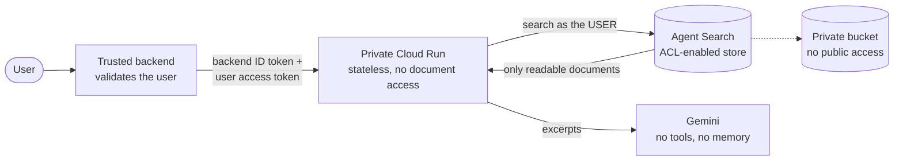

# gcp-search-agent

A Terraform + Google ADK template that deploys a **Gemini Enterprise Agent Platform + Cloud Run hosted agent** backed by your own document corpus. Ask questions in natural language — the agent synthesizes answers and cites source files with direct links. Includes a built-in **automated evaluation suite** that scores every deployment on faithfulness, answer relevance, citation accuracy, and latency using Gemini 3.5 Flash as an LLM judge, plus an **ML observability layer** that logs retrieval telemetry to BigQuery, reranks results with Vertex AI Ranking, scores drift with IsolationForest, and retrains the anomaly model from production traces.

```
$ SESSION=$(curl -s -X POST https://<your-service>/apps/agent/users/u1/sessions \
    -H 'Content-Type: application/json' -d '{}' | python3 -c "import sys,json; print(json.load(sys.stdin)['id'])")

$ curl -s -X POST https://<your-service>/run \
    -H 'Content-Type: application/json' \
    -d "{\"appName\":\"agent\",\"userId\":\"u1\",\"sessionId\":\"$SESSION\", \
        \"newMessage\":{\"role\":\"user\",\"parts\":[{\"text\":\"What should I do if a hydraulic press is leaking oil?\"}]}}" \
  | python3 -c "import sys,json; events=json.load(sys.stdin); [print(p['text']) for e in events for p in e.get('content',{}).get('parts',[]) if 'text' in p]"

If you discover that a hydraulic press is leaking oil, you should immediately stop the machine
and notify maintenance personnel. Do not operate the press while there are active hydraulic leaks.
Use absorbent pads and follow established spill response procedures.

[hydraulic_press_troubleshooting](https://storage.googleapis.com/<bucket>/docs/maintenance/hydraulic_press_troubleshooting.txt)
```

## What it deploys

| Resource | Purpose |
|---|---|
| Cloud Run | Hosts the ADK agent |
| Vertex AI Search (Enterprise) | RAG — indexes documents and retrieves relevant passages (extractive answers) for the LLM to synthesize |
| Vertex AI Ranking API | Re-ranks retrieved chunks before generation |
| Cloud Storage | Stores the document corpus (public read for citation links in sample mode; private in [protected mode](#protected-mode)) |
| BigQuery | Structured telemetry store for retrieval, latency, hallucination, and drift metrics |
| Artifact Registry | Container images for agent builds |
| Workload Identity Federation | Secretless GitHub Actions auth |

## Architecture

```
Cloud Storage (docs/ bucket, public read, HTTPS citation links)
     │ indexed into
     ▼
Vertex AI Search Enterprise (LLM add-on, extractive answers)

User question
     │
     ▼
Cloud Run (Google ADK — Gemini 3.5 Flash via Agent Platform)
     │ calls search_knowledge_base()
     ▼
Retrieved chunks
     │
     ▼
Vertex AI Ranking API + IsolationForest drift scorer
     ├── Gemini 3.5 Flash synthesizes cited answer
     └── BigQuery logs retrieval + answer quality telemetry
```

## Prerequisites

- [Google Cloud SDK](https://cloud.google.com/sdk/docs/install) (`gcloud`)
- [Terraform](https://developer.hashicorp.com/terraform/install) ≥ 1.5 — `brew install hashicorp/tap/terraform`
- [Google ADK](https://google.github.io/adk-docs/) — `pipx install google-adk`
- GCP project with billing enabled
- Owner or sufficient IAM on the project

> **One-time console step:** Before running `provision.sh`, visit  
> `https://console.cloud.google.com/vertex-ai?project=YOUR_PROJECT_ID`  
> and click **Enable APIs** to activate the Agent Platform bundle and accept terms.  
> The script will pause and prompt you for this.

## Quick start

```bash
git clone https://github.com/Metafiziks/gcp-search-agent
cd gcp-search-agent

# Auth
gcloud auth login
gcloud auth application-default login
gcloud auth application-default set-quota-project YOUR_PROJECT_ID

# Set required env vars
export PROJECT_ID=your-gcp-project-id
export GITHUB_REPO=your-org/your-repo   # for Workload Identity setup
export ENV_NAME=search-agent            # drives all resource names
export REGION=us-central1

# Step 1: Provision infrastructure + index documents (~5-10 min)
bash scripts/provision.sh

# Step 2: Deploy agent to Cloud Run (~3 min)
bash scripts/deploy.sh

# Tear everything down when done
bash scripts/teardown.sh
```

## Adding your documents

Drop `.txt` files into `docs/` before running `provision.sh`:

```
docs/
  safety/       lockout_tagout.txt
  maintenance/  hydraulic_press_guide.txt
  quality/      inspection_standard.txt
```

Any folder structure is preserved as the GCS path and appears in citation links.

> Sample mode makes the bucket **publicly readable** so citation links work. Use it only for public documents. For internal knowledge bases use [protected mode](#protected-mode).

## Protected mode

Set `KB_ACCESS_MODE=protected` so the agent answers only from documents the **signed-in end user** may read. It uses [Agent Search data source access control](https://docs.cloud.google.com/generative-ai-app-builder/docs/data-source-access-control) (**Preview**): each document carries an ACL, and Search filters results against the caller's identity. The agent searches with the user's own Google access token, not its service account, and the model never makes access decisions. This is the GCP counterpart of the Azure Purview mode, but ACLs come from a manifest you supply rather than labels inside the files.



```bash
export KB_ACCESS_MODE=protected PROJECT_ID=<dedicated-project>
export SEARCH_MEMBERS="user:a@example.com" BACKEND_INVOKERS="serviceAccount:backend@<project>.iam.gserviceaccount.com"
bash scripts/provision.sh                                   # private bucket, ACL-enabled store, least-privilege IAM
python3 scripts/ingest_protected.py --project <project> --bucket <bucket> --datastore <ds> --engine <engine> \
  --directory /path/outside/repo                            # files + acl.json, waits for a clean import
bash scripts/deploy.sh                                      # private Cloud Run, no evals/telemetry/sessions
python3 scripts/test_protected_live.py --service-url <url> --bucket <bucket> ...   # two-user acceptance test
bash scripts/teardown.sh
```

Optionally `CREATE_PROJECT=1` / `DELETE_PROJECT=1` also create and delete the dedicated project. Protected mode uses a separate Terraform root (`terraform/protected`) and never creates the public bucket or uploads `docs/`; default behavior is unchanged. Live-tested end to end in November 2026 (provision, ingest, deploy, two-user acceptance, teardown): user A got the restricted fact with a citation, user B and the control got nothing, and anonymous reads were denied. **Access control is eventually consistent after an import (an unauthorized user retrieved the restricted document for about ten minutes in testing): keep real traffic off until the acceptance gate passes.** Needs a project under a Google Workspace / Cloud Identity organization (or Workforce Identity Federation), not a no-domain org. Setup, calling convention, acceptance test and limits (not file encryption, Preview, no documented ACL propagation time, not production app sign-in) are in the [protected-mode guide](guides/protected-mode.md).

## Environment variables

| Variable | Required | Default | Description |
|---|---|---|---|
| `PROJECT_ID` | ✅ | — | GCP project ID |
| `GITHUB_REPO` | ✅ | — | `owner/repo` for Workload Identity |
| `ENV_NAME` | — | `search-agent` | Prefix for all resource names |
| `REGION` | — | `us-central1` | Cloud Run + Artifact Registry region |
| `GEMINI_MODEL` | — | `gemini-3.5-flash` | Override the Gemini model (`gemini-2.5-*` was retired 2026-10-20) |
| `GEMINI_LOCATION` | — | `global` | Vertex AI location for Gemini calls; current models are served from `global` |
| `KB_ACCESS_MODE` | — | `sample` | `sample` or `protected` (see [Protected mode](#protected-mode)) |
| `SEARCH_MEMBERS` / `BACKEND_INVOKERS` / `INGEST_OPERATORS` | protected | — / — / active account | IAM members that may search / invoke the service / ingest |
| `PROTECTED_ACCEPTANCE_CONFIG` | — | — | JSON path; makes `deploy.sh` run the two-user acceptance gate |
| `CREATE_PROJECT` / `DELETE_PROJECT` | — | off | Protected mode only: create a labelled dedicated project (needs `ORGANIZATION_ID`/`FOLDER_ID` + `BILLING_ACCOUNT_ID`) / delete it at teardown, only if this tool created it |

## GitHub Actions CI/CD

`deploy.sh` sets all required repo variables automatically if `gh` is authenticated. To set them manually:

```bash
gh variable set WIF_PROVIDER        --body "$(terraform -chdir=terraform output -raw wif_provider)"
gh variable set WIF_SERVICE_ACCOUNT --body "$(terraform -chdir=terraform output -raw deployer_service_account)"
gh variable set PROJECT_ID          --body "$PROJECT_ID"
gh variable set SERVICE_URL         --body "$(gcloud run services describe search-agent --region us-central1 --project $PROJECT_ID --format='value(status.url)')"
```

Then activate the workflows by copying them into `.github/workflows/`:

```bash
cp workflows/*.yml .github/workflows/
git add .github/workflows/ && git commit -m "Activate CI workflows" && git push
```

| Workflow | Trigger | What it does |
|---|---|---|
| `deploy.yml` | Push to `src/` | Rebuilds and redeploys the Cloud Run agent |
| `run-evals.yml` | Push to `src/` or `tests/`, weekly | Runs the 12-case eval suite via Gemini judge; fails CI if metrics drop below threshold |
| `retrain-observability.yml` | Weekly or manual | Retrains the IsolationForest drift model from the last 30 days of BigQuery telemetry and uploads `model.pkl` to GCS |

No GCP credentials stored as secrets — all auth via Workload Identity Federation.

## ML Observability

The template ships with a three-layer observability stack that goes beyond threshold alerts to detect subtle drift before it becomes visible to users.

### What runs where

| Component | Where | When |
|-----------|-------|------|
| **Vertex AI Ranking API** | Agent (Cloud Run) | Every request — re-ranks retrieved chunks for better relevance |
| **IsolationForest scorer** | Agent (Cloud Run) | Every request — flags anomalous retrieval patterns |
| **BigQuery telemetry** | Agent (Cloud Run) | Every request — logs retrieval features as structured rows |
| **HHEM hallucination scorer** | Eval runner | Every eval run — scores answer consistency |
| **IForest baseline training** | Deploy time | Once — bootstraps model from eval telemetry |
| **IForest retraining** | Weekly (GitHub Actions) | Adapts model to production traffic distribution |

### How it works

**Runtime (every request):**
```
User query
    ↓
Vertex AI Search — retrieves top-8 chunks, records relevance scores
    ↓
Vertex AI Ranking API — re-ranks chunks by semantic relevance (semantic-ranker-512)
    ↓
IsolationForest — scores the 6-feature retrieval vector for anomalies
    ↓
BigQuery — logs telemetry row (fire-and-forget daemon thread, non-blocking)
    ↓
Gemini — generates answer from re-ranked top-5 chunks
```

**Eval time (each eval run):**
```
Eval runner asks question → records answer + latency
    ↓
HHEM (vectara/hallucination_evaluation_model) — scores hallucination probability
    ↓
BigQuery — logs answer-quality row (hhem_score, answer_length, citation_count, latency_ms)
```

**Weekly (GitHub Actions cron):**
```
Pull last 30 days of BigQuery telemetry
    ↓
Retrain IsolationForest on production distribution
    ↓
Upload new model.pkl to GCS
    ↓
Agent picks up new model on next cold start
```

### Detecting drift with BigQuery

Because every request is logged to BigQuery, you can query across time to detect degradation:

```sql
-- Faithfulness trend (7-day rolling)
SELECT
  DATE(timestamp) AS day,
  AVG(hhem_score) AS avg_hallucination_prob,
  COUNT(*) AS requests
FROM `project.agent_observability.telemetry`
WHERE timestamp >= TIMESTAMP_SUB(CURRENT_TIMESTAMP(), INTERVAL 30 DAY)
  AND source = 'eval'
GROUP BY day
ORDER BY day;

-- Anomaly rate over time
SELECT
  DATE(timestamp) AS day,
  COUNTIF(is_anomaly) / COUNT(*) AS anomaly_rate,
  AVG(retrieval_score_mean) AS avg_retrieval_score
FROM `project.agent_observability.telemetry`
WHERE timestamp >= TIMESTAMP_SUB(CURRENT_TIMESTAMP(), INTERVAL 30 DAY)
  AND source = 'runtime'
GROUP BY day
ORDER BY day;
```

### Baseline training

At deploy time, `deploy.sh` runs the eval suite 5× to collect 60 baseline "healthy" rows in BigQuery, then trains the initial IsolationForest:

```bash
PROJECT_ID=your-project \
GCS_MODEL_PATH=gs://your-bucket/models/iforest.pkl \
python3 observability/train_baseline.py
```

The agent loads the model from GCS at startup via the `GCS_MODEL_PATH` env var. If the model isn't present yet (first deploy), anomaly scoring is disabled gracefully — the agent still works, it just logs `anomaly_score=0`.

### Manual retraining

```bash
PROJECT_ID=your-project \
GCS_MODEL_PATH=gs://your-bucket/models/iforest.pkl \
RETRAIN_LOOKBACK_DAYS=30 \
python3 observability/retrain.py
```

Or trigger the workflow manually from the Actions tab.

### Telemetry schema

| Column | Type | Source | Description |
|--------|------|--------|-------------|
| `retrieval_score_mean` | FLOAT64 | Runtime | Mean chunk relevance from Vertex AI Search |
| `retrieval_score_entropy` | FLOAT64 | Runtime | Score distribution entropy (low = skewed toward one chunk) |
| `reranker_score_mean` | FLOAT64 | Runtime | Mean semantic-ranker-512 score |
| `chunk_count` | INT64 | Runtime | Number of chunks retrieved |
| `search_latency_ms` | FLOAT64 | Runtime | Vertex AI Search wall-clock time |
| `anomaly_score` | FLOAT64 | Runtime | IForest decision function (negative = anomalous) |
| `hhem_score` | FLOAT64 | Eval | Hallucination probability [0=consistent, 1=hallucinated] |
| `latency_ms` | FLOAT64 | Eval | End-to-end request latency |


After deploying:

```bash
bash scripts/eval.sh
```

`eval.sh` resolves the Cloud Run service URL from `gcloud` automatically. To skip the Gemini judge:

```bash
bash scripts/eval.sh --no-judge
```

Results are written to `eval_results.json`. Metrics scored:

| Metric | Method | Pass threshold |
|---|---|---|
| Keyword Recall | Deterministic | ≥ 0.65 |
| Citation Recall | Deterministic | ≥ 0.60 |
| p95 Latency | Deterministic | ≤ 25000ms |
| Faithfulness | Gemini 3.5 Flash judge | ≥ 0.70 |
| Answer Relevance | Gemini 3.5 Flash judge | ≥ 0.75 |

**Keeping evals in sync with your docs:**

When you change files in `docs/`, regenerate the eval cases before re-running:

```bash
PROJECT_ID=your-project-id python3 scripts/generate_eval_cases.py
bash scripts/eval.sh
```

`generate_eval_cases.py` reads every `.txt` file under `docs/`, calls Gemini 3.5 Flash to generate 2 Q&A test cases per document, and writes `tests/eval_cases.json`. Running `bash scripts/provision.sh` does this automatically after each doc sync.

## Comparison across cloud providers

| | This template (GCP) | [AWS](https://github.com/Metafiziks/aws-bedrock-agent) | [Azure](https://github.com/Metafiziks/azd-foundry-search-agent) |
|---|---|---|---|
| Provision | `bash scripts/provision.sh` | `bash scripts/provision.sh` | `azd provision` |
| LLM | Gemini 3.5 Flash (Vertex AI) | Amazon Nova Lite (Bedrock) | GPT-5 (Azure AI Foundry) |
| Agent SDK | Google ADK + Cloud Run | Bedrock Agents (managed) | AI Foundry hosted agent |
| RAG | Vertex AI Search Enterprise | Bedrock Knowledge Bases | Azure AI Search |
| Vector store | Vertex AI Search (built-in) | OpenSearch Serverless | Azure AI Search (built-in) |
| Auth | Workload Identity Federation | GitHub OIDC | Azure OIDC |
| Eval judge | Gemini 3.5 Flash | Amazon Nova Pro | GPT-5 |
| Protected mode | `KB_ACCESS_MODE=protected` (Agent Search ACLs, Preview) | — | `KB_ACCESS_MODE=purview` (Purview labels, preview) |
| Teardown | `bash scripts/teardown.sh` | `bash scripts/teardown.sh` | `azd down` |

## Teardown

```bash
export PROJECT_ID=your-gcp-project-id
export ENV_NAME=search-agent   # must match what you used for provision
export REGION=us-central1

bash scripts/teardown.sh
```

Deletes the Cloud Run service first (deployed outside Terraform by ADK), then runs `terraform destroy` to remove all remaining resources — storage bucket, Vertex AI Search engine, data store, service accounts, Workload Identity pool, and Artifact Registry.

## Troubleshooting

| Error | Fix |
|---|---|
| `cloudresourcemanager.googleapis.com` not enabled | Run `gcloud services enable cloudresourcemanager.googleapis.com` first |
| `Publisher model ... was not found` | Enable Agent Platform APIs in the console (see prerequisite above) |
| `Cannot use enterprise edition features` | Upgrade search engine tier via REST PATCH or recreate with `SEARCH_TIER_ENTERPRISE` |
| `serving config not found` | Ensure serving config name is `default_search` (not `default_config`) |
| `gsutil` Python version error | Use `gcloud storage rsync` instead |
