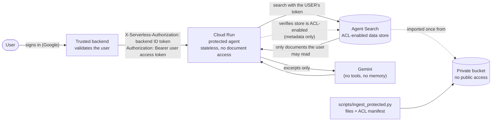

# Protected mode: document-level access control

Set `KB_ACCESS_MODE=protected` to answer only from documents the **signed-in end
user** is allowed to read. It uses [Agent Search data source access control][acl]
(Vertex AI Search, **Preview**): every document carries an `acl_info` reader list, and
Search filters results against the identity of the caller. The agent searches with the
user's own Google access token, never its service account, and never lets the model
decide who may see what.

This is the Google Cloud counterpart of the Azure Purview mode. The mechanisms differ:
Purview enforces rights from sensitivity labels embedded in files, while Agent Search
enforces ACLs that you supply at import time. Nothing here reads labels from the files.



## Prerequisite: a managed identity provider

Agent Search must know who "the user" is. **Google identity** (`IDP_TYPE=GSUITE`, the default)
needs a project whose Google Cloud *organization is linked to a Cloud Identity or Google
Workspace customer*; users and groups are those directory accounts. Consumer `@gmail.com`
accounts in a "no-domain" organization are rejected (observed live:
`Project's GCP Organization is not associated with a Cloud Identity customer id`). Without a
directory, use **Workforce Identity Federation** (`IDP_TYPE=THIRD_PARTY`,
`WORKFORCE_POOL_NAME=locations/global/workforcePools/<pool>`) with your own OIDC/SAML provider.

## What gets deployed

`KB_ACCESS_MODE=protected bash scripts/provision.sh` runs the separate Terraform root
`terraform/protected` (own state; the default deployment is untouched):

| Resource | Protection |
|---|---|
| Private bucket | Uniform access, public access prevention **enforced**, no `allUsers`, no ACLs, no keys |
| ACL-enabled data store + engine | `acl_enabled = true` (immutable), engine serves **only** this store |
| Identity provider | Project-wide Agent Search setting: `GSUITE` (Cloud Identity / Workspace) or `THIRD_PARTY` (Workforce Identity Federation) |
| Runtime service account | Gemini plus read of store/engine **metadata**; cannot search, list or read documents, no bucket access |
| Custom roles | `search_user` (search + `serviceusage.services.use`), `ingest` (import documents), `verify` (metadata) |

`bash scripts/deploy.sh` deploys the private Cloud Run service `<env>-protected` with
`--no-allow-unauthenticated` and fails if any public invoker binding exists. It skips
sample evals, BigQuery telemetry, the reranker and ADK sessions. The sample corpus in
`docs/` is never uploaded.

The service answers with `gemini-3.5-flash` from the **global** Vertex AI endpoint
(`GEMINI_MODEL`, `GEMINI_LOCATION` override this). Google retired `gemini-2.5-flash`,
`2.5-flash-lite` and `2.5-pro` on 2026-10-20, and in live testing the current models
returned 404 from `us-central1` but worked from `global`. Check
[Google's model lifecycle page](https://docs.cloud.google.com/vertex-ai/generative-ai/docs/learn/model-versions)
before pinning a model. In organizations that no longer grant the default Compute service
account build roles, Terraform grants it `roles/cloudbuild.builds.builder`
(`grant_build_roles=false` to skip).

```bash
export KB_ACCESS_MODE=protected PROJECT_ID=<dedicated-project> ENV_NAME=<env>
export SEARCH_MEMBERS="user:a@example.com,group:team@example.com"   # may search
export BACKEND_INVOKERS="serviceAccount:backend@<project>.iam.gserviceaccount.com"
bash scripts/provision.sh
bash scripts/deploy.sh
bash scripts/teardown.sh
```

**Optional: let the scripts create and delete the project.** Off by default. Set
`CREATE_PROJECT=1` with `ORGANIZATION_ID` (or `FOLDER_ID`) and `BILLING_ACCOUNT_ID` and `provision.sh`
creates a fresh, labelled project (`created-by=gcp-search-agent-protected`), links billing, and remembers
its ID in `.protected-project` so `deploy.sh` and `teardown.sh` find it without `PROJECT_ID`. Set
`DELETE_PROJECT=1` on teardown to delete it afterwards. Teardown refuses unless the project carries that label
(so it can never delete a project it did not create) and no other Cloud Run service runs in it, and it asks
you to type the project ID unless `ASSUME_YES=1`. Deletion is restorable for 30 days
(`gcloud projects undelete <id>`), but the project ID can never be reused. The account needs permission to
create projects under the parent and to link billing.

```bash
export KB_ACCESS_MODE=protected CREATE_PROJECT=1 ORGANIZATION_ID=<org-id> BILLING_ACCOUNT_ID=<billing-id>
bash scripts/provision.sh && bash scripts/deploy.sh
DELETE_PROJECT=1 bash scripts/teardown.sh
```

Use a dedicated project where you can. The identity provider is one setting per
project and location, so protected mode changes it for every Agent Search app in the
project (set `MANAGE_ACL_CONFIG=false` if one is already configured).

## Ingest a corpus

Keep the approved corpus in a directory **outside** this repository (the script
refuses paths inside it) with an `acl.json` manifest. Every file needs an explicit
entry. Agent Search rejects ACL documents with no readers, so an entry with no readers is uploaded to the
private bucket but **not imported**, which makes it unsearchable (the equivalent of an unlabeled control).
There is no "everyone" option.

```json
{"policy.pdf": {"users": ["alice@example.com"], "groups": ["safety-team@example.com"]},
 "draft.txt":  {"users": [], "groups": []}}
```

```bash
python3 scripts/ingest_protected.py --project <project> --bucket <bucket> \
  --datastore <datastore> --engine <engine> --directory /path/outside/repo
```

It checks the destination (private bucket, ACL-enabled store, single-store engine),
uploads with your own credentials, imports with `dataSchema=document`, and succeeds
only if the import reports every document ingested with zero failures and no error
samples. Supported types: `.txt`, `.html`, `.pdf`, `.docx`, `.pptx`. User and group IDs
must be the Google account or group **email addresses**. Your operator needs the `ingest`
role (granted by `INGEST_OPERATORS`, default: the active gcloud account).

## Calling the agent

The existing company backend validates the user's sign-in, then calls:

```
POST <service-url>/ask
X-Serverless-Authorization: Bearer <backend ID token, audience = service URL>
Authorization: Bearer <the signed-in user's Google access token>
{"input": "<question>", "store": false, "background": false}
```

* Cloud Run IAM (`roles/run.invoker`, only `BACKEND_INVOKERS`) decides which backend may call.
* The user token needs the `https://www.googleapis.com/auth/cloud-platform` scope. The user needs the
  `search_user` role (`SEARCH_MEMBERS`).
* Never accept the user's identity or token from browser-supplied headers, and do not
  log or trace them. The agent ignores `X-Goog-Authenticated-User-*`, IAP and similar headers.
* Send no conversation or previous response; `store` must be `false`. Do not cache
  protected answers or replay them into later requests.
* The response is `{"status":"completed","text":…,"sources":[filenames]}`: source
  filenames only, no public URLs. A user with no readable matches gets a completed
  "could not find information" response.

## What the agent enforces vs. what the platform enforces

Agent Search applies the ACLs. The agent only: passes the user's token through to Search,
verifies on every request that the store is ACL-enabled and is the engine's only store
(otherwise it fails closed with 503), drops any result not from the protected bucket,
makes no model call when nothing is returned, and keeps no state. It cannot see
`acl_info` per result and `GetDocument`/`ListDocuments` are blocked on ACL stores.

## Access control is eventually consistent after an import

This is the most important operational limit found in live testing. After a fresh import, Agent Search did **not**
enforce the ACLs consistently for roughly the first ten minutes: a user who was not a reader sporadically
retrieved the restricted document (alternating with correct empty results), while the authorized user always
did. After that, 48 consecutive queries as the denied user returned nothing. An earlier run in a project whose
corpus had already settled showed no exposure at all. Google documents no propagation time, and ten minutes was
one observation, not a guarantee.

What to do about it:

* **Treat a newly imported or changed corpus as exposed until verified.** Do not send real user traffic to the
  service, and do not announce it, until the acceptance gate has passed for that import.
* **Re-run the gate after every re-import**, including ACL changes and revocations; assume a revocation is not
  effective until the denied user has been clean for a long stretch.
* The gate (`test_protected_live.py`) therefore does not trust one check. It requires `--clean-streak` (default 30)
  **consecutive** clean denied-user checks, resetting on any exposure, within `--settle-timeout` (default 1500 s),
  prints a warning for every exposure it observed while settling, and re-checks the denied user at the end. It
  fails if the denial never settles or if the document is exposed after it settled.
* The agent cannot detect this: it has no per-result ACL view, so it relies entirely on Agent Search.

## Verify before accepting traffic

Create two synthetic fixtures in a dedicated directory outside the repo: a restricted
document only user A may read and a control with no readers (uploaded, never imported) and a different fact. Save
this non-secret JSON outside the checkout (no tokens):

```json
{
  "directory": "/absolute/path/to/synthetic-fixtures",
  "allowed_user": "usera@example.com",
  "denied_user": "userb@example.com",
  "approved_file": "approved.txt",
  "control_file": "control.txt",
  "question": "What is the restricted test access code?",
  "expected": "ORCHID-47",
  "control_question": "What is the unrestricted control code?",
  "control_expected": "MAPLE-82"
}
```

```bash
export PROTECTED_ACCEPTANCE_CONFIG=/absolute/path/to/protected-acceptance.json
bash scripts/deploy.sh          # or run test_protected_live.py directly
```

The gate ingests the two files, then prompts without echo for the backend ID token and
the two users' access tokens (and optionally an expired one). Get them in a terminal,
one gcloud config directory per user:

```bash
CLOUDSDK_CONFIG=~/.gcloud-usera gcloud auth login
CLOUDSDK_CONFIG=~/.gcloud-usera gcloud auth print-access-token
gcloud auth print-identity-token --audiences=<service-url>   # as an identity with run.invoker
```

For a local run you can let the script mint the tokens from signed-in gcloud sessions
instead of prompting (never printed or stored): add `--tokens-from-gcloud --backend-account <acct>`
and, if a user has a separate gcloud configuration, `--allowed-gcloud-config` / `--denied-gcloud-config <dir>`.

It fails the command unless user A gets the fact with a citation, user B gets a completed
response with no documents, the control is never disclosed or cited, browser identity
headers change nothing, missing and expired user credentials and stateful requests
are rejected, a call without the backend credential is rejected, and anonymous storage
reads are denied. Newly imported documents can take a few minutes to become searchable;
the approved check retries until `--ready-timeout` (default 600 s).

## Live validation

Disposable runs in November 2026 under a Google Workspace organization. The final run used the fully automated
path: `CREATE_PROJECT=1 provision.sh`, `deploy.sh` with the acceptance gate, then `DELETE_PROJECT=1 teardown.sh`.
Two things failed first and were fixed: Terraform ran before the new project's creator roles had propagated
(`USER_PROJECT_DENIED`, now a wait-until-usable step), and the first gate run caught the post-import exposure
described above (the gate was then tightened).

| Check | Result |
|---|---|
| Provision | 26 resources in a script-created, labelled project, Google-identity access control accepted. An earlier attempt in a "no-domain" organization was rejected with `not associated with a Cloud Identity customer id`. |
| Import | Rejected a document with an empty reader list (hence the no-readers rule above); the corrected import ingested every ACL document with no errors. |
| User A (reader) | Completed answer with the restricted fact and the `approved.txt` citation. |
| Settle gate (final run) | 30 consecutive clean denied-user checks (0 exposures after a re-import), 12 more at the end. |
| User B (not a reader, a different directory user) | Completed response with no documents once the corpus had settled. **Right after a fresh import, B sporadically retrieved the restricted document** (see above), so the gate was tightened. |
| Control (never imported) | Not disclosed or cited when user A asked. |
| Forged identity headers; missing and invalid user token; stateful requests (`store`, `previous_response_id`, `conversation`); missing backend credential | Ignored (result unchanged); 401; 400; 401. |
| Anonymous storage reads | 403 for both files. |
| Teardown + delete | All Terraform resources, the service, and its source uploads and image removed, then the script-created project deleted (state `DELETE_REQUESTED`, restorable for 30 days); verified none left. |

Not exercised: a genuinely **expired** token (an invalid one was rejected instead), Workforce
Identity Federation, the propagation delay after an ACL change, and what a service-account
caller would see (impersonation was not permitted for the test account). The two test users
were real directory users; the test used `gcloud` tokens, not an application sign-in.

## What this does NOT prove

* **Not file encryption.** It verifies retrieval permissions, not that objects are
  encrypted or unreadable to people with bucket access. Bucket IAM stays your control.
* **Preview feature.** Agent Search access control is Preview; behavior and terms can change.
* **Propagation is undocumented and was observed to be minutes, not instant.** ACLs change only by re-ingesting (`reconciliationMode=FULL`
  replaces the data). Treat revocations as effective only after a re-import completes and
  verification passes; Google documents no propagation time. For urgent removal, take the
  data store or service out of service.
* **Not production app sign-in.** The test uses `gcloud` tokens. Your app must obtain
  user tokens through its own OAuth client and validate the user before calling the agent.
* **Google identities only.** ACL principals are Google account/group emails (or a
  Workforce Identity Federation mapping, not covered by these scripts); users outside the
  configured identity provider cannot be granted access.
* Does not read sensitivity labels from files; ACLs come from your manifest.
* Protected mode keeps no memory or stored conversations. Do not enable content logging
  for it or put restricted files in `docs/`.

After a test, run `bash scripts/teardown.sh` with the same variables. It removes the
service, bucket, data store and Terraform-created IAM; check separately created test
users, groups or tokens yourself.

[acl]: https://docs.cloud.google.com/generative-ai-app-builder/docs/data-source-access-control
